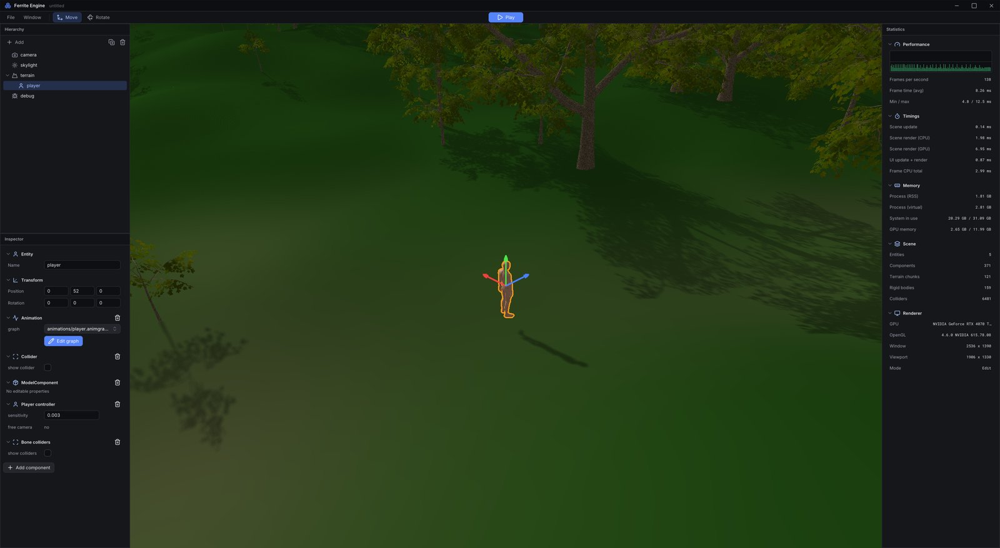
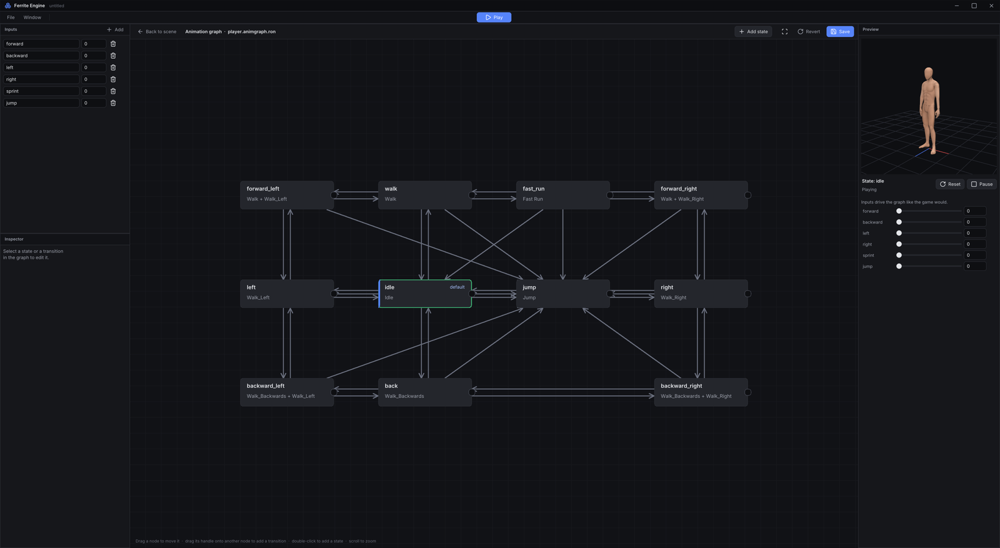

# Ferrite

[](https://github.com/netcodedev/ferriteengine/actions/workflows/rust.yml)

A personal project to get a better understanding of Rust and OpenGL: a 3D engine with voxel terrain, skeletal animation and physics, plus its own UI library and a scene editor built on top of it.



## Crates

| Crate | Path | |
| --- | --- | --- |
| `ferrite` | `crates/engine` | The engine: rendering, scenes and entities, terrain, animation, physics |
| `ferrite-ui` | `crates/engine-ui` | Retained-mode UI library used by the editor |
| `ferrite-editor` | `crates/editor` | Scene and animation graph editor |
| `sandbox` | `crates/sandbox` | Small demo world to play around in |

## Features

**Engine**

- Chunked, multithreaded terrain generation (voxel with greedy meshing, marching cubes, dual contouring)
- Instanced tree forests
- Sky, sky light and shadow mapping
- 3D model loading via Assimp, skeletal animation with blending and root motion
- Animation graphs (states, blends and transitions) defined in RON files
- Physics with [Rapier](https://rapier.rs): rigid bodies, colliders, a player capsule and per-bone colliders
- Entity/component scenes, saved and loaded as RON
- Text and line rendering

**UI library**

- Panels, buttons, inputs with selection and caret, sliders, checkboxes, toggles, radio buttons, color picker
- Dropdowns, menus, tabs, trees, lists, collapsible sections, scroll areas, popups and tooltips
- A shared dark theme with the Inter font and Lucide icons

**Editor**

- Docked, resizable panels: hierarchy, inspector, viewport and statistics
- Selection by clicking in the viewport, move and rotate gizmos, outline of the selected entity
- Inspector for every component, adding and removing components
- Play mode that runs the scene and restores it on stop
- Node-based animation graph editor with a live 3D preview



## Building

### Linux

The engine needs Assimp, Clang (for bindgen), CMake and the X11/Wayland headers for GLFW. On Ubuntu:

```shell
sudo apt install -y cmake pkg-config libassimp-dev libclang-dev libssl-dev zlib1g-dev \
  libx11-dev libxrandr-dev libxinerama-dev libxcursor-dev libxi-dev \
  libwayland-dev libxkbcommon-dev
```

Then build the workspace:

```shell
cargo build --workspace
```

## Running

Run from the repository root so the `assets/` folder is found.

### Editor

```shell
cargo run -p ferrite-editor
```

| Input | Action |
| --- | --- |
| Hold right mouse + WASD / Q / E | Fly through the viewport (Shift to speed up) |
| Left click | Select an entity |
| W / E | Move / rotate gizmo |
| F | Focus the selected entity |
| Ctrl+D / Del | Duplicate / delete the selected entity |
| Ctrl+P | Enter or leave play mode |
| Ctrl+N / Ctrl+O / Ctrl+S / Ctrl+Shift+S | New, open, save, save as (scenes live in `scenes/`) |

To edit an animation graph, select an entity with an Animation component and click **Edit graph** in the inspector.

### Sandbox

```shell
cargo run -p sandbox
```

WASD moves the player, Shift sprints, Space jumps and Escape toggles a free camera.

## Planned

- Inverse kinematics
- Infinite world generation
- Water
- Particles
