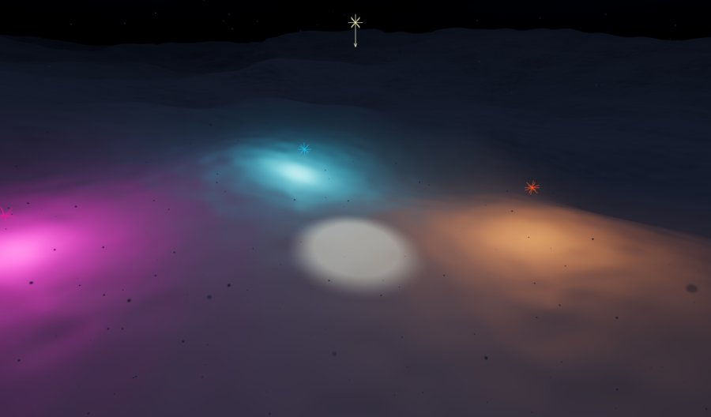
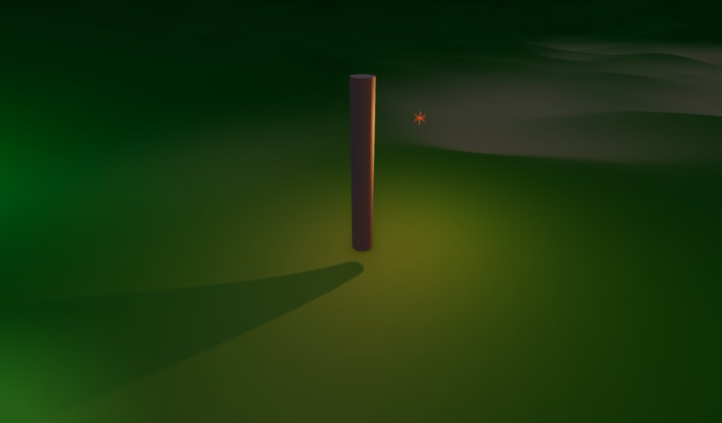
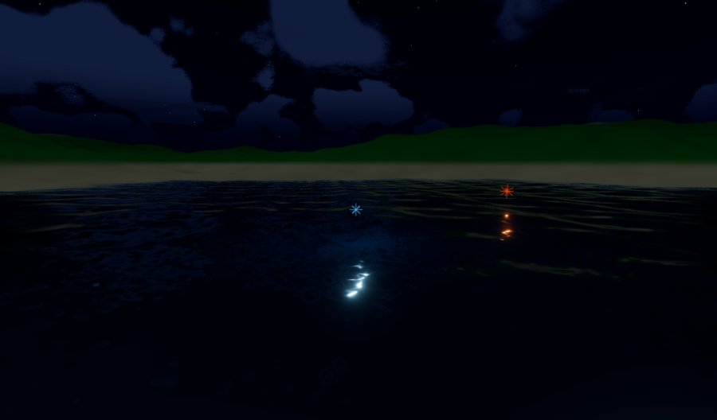
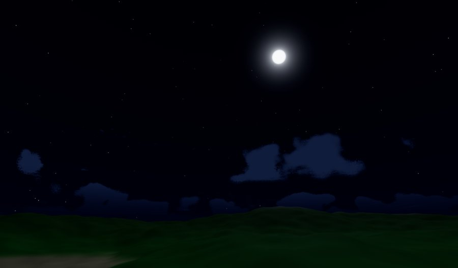

# Lighting

A scene is lit by the sun and the sky (the **Sky light** component), the
moon at night, and any number of **lights** placed on entities. Light that
does not come straight from a lamp or the sun — moonlight, the night sky,
lamp light bouncing off the ground and walls — is what Ferrite calls its
global illumination. It keeps nights from going black.



## Lights

Add a light with "Add component" → **Point light**, **Spot light** or
**Directional light** (they are one component, `Light`, with a `kind`).
The light sits where its entity is; spot and directional lights shine
along the entity's **−Y axis**, straight down until the entity is rotated.

| Property | |
| --- | --- |
| `kind` | `Point`: in every direction from one point. `Spot`: in a cone. `Directional`: parallel light everywhere, like a second sun without shadows |
| `enabled` | Switched off lights cost nothing |
| `shadows` | Point and spot lights: whether things block the light (default on; see below) |
| `color r/g/b` | sRGB, 0 to 1, as a colour picker shows it |
| `intensity` | What a surface 1 m away facing the light gets. The midday sun is about 3.5 on this scale; a lantern 5–20, a street lamp spot 50–150 |
| `range` | Metres at which a point or spot light has faded to nothing (it falls off with the square of the distance before that) |
| `inner angle` / `outer angle` | Spot lights: half angles of the fully lit core and of the edge, in degrees |
| `bounce` | How much of its light bounces onto the surroundings (see below); 0 lights only what it shines on |

In the editor every light shows as a small star in its colour (grey when
switched off) and can be clicked there. The selected one also shows where
it reaches: three circles at its range, its cone, or its direction.

Up to **64** lights are shaded per frame. With more in the scene, the ones
whose range the camera is in or nearest win; directional lights always
count. Every lit surface (terrain, models, shapes, scattered trees, the
snow layer) takes them, and falling rain and snow catch them too.

## Shadows of lights

Point and spot lights with `shadows` on cast shadows: whatever stands
between a lamp and a surface — terrain, models, shapes, trees, the snow
layer — keeps its light off it. Edges are soft (filtered over a few
texels), and bounce light still gets around corners, as it should.



Each shadowed light gets a depth cube map (six 90° views, 512 × 512 per
face). The **4** shadow casting lights nearest the camera get one each
frame; lights further away shine unshadowed until the camera comes
closer, so switch `shadows` off on lights where it does not matter (a
light far from anything, a fill light) to keep those four for the ones
that do. Directional lights have no shadows.

Drawing the scene six times per light is what costs, so at most 12 faces
are drawn per frame. A light that is new or has moved (or changed range
or angle) gets all its faces at once; the rest are refreshed in turn, so
with four point lights a moving object's shadow updates every second
frame. A spot light only draws the faces its cone reaches — a narrow
spot pointing down just one.

## Water

Water mirrors lamps: each light leaves a glint on the surface, drawn out
into a streak by the waves, and lights the water around it a little. Their
shadows apply to the reflection too. The moon lights the water at night.



## The moon and the night sky

The sky light has a moon. It is across the sky from the sun (its path
tilted a little), shines a cool blue at about a tenth of the sun, and is
drawn in the sky with its glow; clouds are lit by it. Once the sun has set,
the shadow map is cast from the moon, so trees still throw moon shadows.
The hand-over happens while the sun is below the horizon, where neither
gives much light, so there is no jump.



Where the moon does not reach, the night sky's own glow (stars, airglow)
keeps a little light on everything.

## Global illumination settings

On the **Sky light**:

| Property | Default | |
| --- | --- | --- |
| `moonlight` | 1 | Brightness of the moon; 0 for moonless nights (0–4) |
| `night sky light` | 1 | Ambient light of the night sky; 0 for pitch-black nights (0–8) |
| `light bounce` | 1 | Scales every light's bounce; 0 switches bounce off (0–4) |

### How bounce works

It is an approximation, not traced light. Each light adds a soft, wide
term to the ambient light around it: it reaches about twice the light's
range, gets around corners and onto sides facing away, and is darkened by
ambient occlusion like the sky's light. A spot light's bounce comes from
where its cone points and in proportion to the light it sends out; a
directional light's comes up from the ground everywhere. It is coloured
like the light, and coloured again by the surface it lands on (red light
on green grass stays dark — as it would).

## In a scene file

```ron
(
    id: 2001,
    name: "lantern",
    position: (4.0, 53.5, 10.0),
    rotation: (1.0, 0.0, 0.0, 0.0),
    components: [
        Light(kind: Point, color: (1.0, 0.6, 0.25), intensity: 15.0, range: 14.0),
    ],
),
```

Every field of `Light` may be left out for its default (a warm point light,
intensity 8, range 12, with shadows). The sky light keeps the global illumination
settings in `global_illumination: (moonlight: 1.0, night_sky: 1.0, bounce: 1.0)`;
scenes saved before it existed get the defaults.

## Through the MCP server

```jsonc
{"tool": "editor_add_entity", "arguments": {"name": "Street lamp", "position": [2, 62, 8]}}
{"tool": "editor_add_component", "arguments": {"id": 1234,
  "ron": "Light(kind: Spot, color: (1.0, 1.0, 0.9), intensity: 120.0, range: 20.0, outer_angle: 20.0)"}}
{"tool": "editor_set_property", "arguments": {"id": 1234, "component_index": 0,
  "name": "color b", "value": 0.5}}
// The sky light: night, a brighter moon.
{"tool": "editor_set_property", "arguments": {"id": 1002, "component_index": 0,
  "name": "time of day", "value": 0.0}}
{"tool": "editor_set_property", "arguments": {"id": 1002, "component_index": 0,
  "name": "moonlight", "value": 1.5}}
```

## For engine code

- `core/renderer/light/light.rs`: the `Light` component, `LightSettings`,
  gathering and choosing the frame's lights, and the uniform buffer
  (`LightBuffer`, binding 1) they are uploaded to once a frame.
- `core/renderer/light/global_illumination.rs`: `GlobalIllumination`, the
  moon's direction and when it takes over the shadows.
- `core/renderer/pbr/lighting.glsl`: `localLights` (direct light, same
  BRDF as the sun), `localBounce`, `localLightAt` (all round, for
  particles), `moonRadiance` and the night sky in `skyLight`.
  `MAX_LIGHTS` there must match `light::MAX_LIGHTS`.
- `core/renderer/light/shadow.rs`: choosing the shadowed lights
  (`assign`), which faces are drawn each frame (`ShadowPlanner`), the face
  matrices and the cube map array (`LightShadowMaps`, texture unit 16).
  `lightShadow` in `lighting.glsl` looks them up; the water's lamp
  reflections are `lampReflections` in `water_fragment.glsl`.
- A shader that includes `LIGHTING_GLSL` and calls `Lighting::apply` gets
  all of it; `Lighting::preview` shades without lights or moon.
