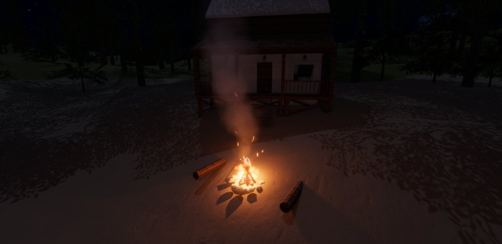

# Particles

Fire, smoke, embers, sparks, dust, wood chips, fireflies, mist: a
**Particles** component on an entity sends out particles as its effect
says. They are simulated on the CPU and drawn as camera-facing quads after
the opaque scene, in play mode and in the editor alike, so an effect can be
tuned while you watch it.



## Adding one

"Add component" offers each preset: **Particles: Fire**, **Smoke**,
**Embers**, **Sparks**, **Dust**, **Wood chips**, **Fireflies**, **Mist**.
The inspector's `preset` field switches an emitter to another one (and
shows which it is until something is changed). A campfire is several
entities: flames, embers and smoke as children of the fire's model, and a
point light with `flicker`.

In the editor every emitter shows as a small diamond in the colour of its
particles; the selected one also shows its shape and direction. A
one-shot effect (a burst that does not loop) plays again and again while
the scene is edited.

## The effect

| Field | |
| --- | --- |
| `enabled`, `looping`, `duration` | It emits for `duration` seconds, then starts again or stops |
| `rate`, `burst` | Particles a second, and all at once at the start (and each loop) |
| `max_particles` | No more alive at once |
| `lifetime` | Seconds each lives, `[min, max]` |
| `shape` | Where they start: `Point`, `Sphere(radius)`, `Box((x, y, z))` half sizes, `Disc(radius)` flat in the entity's xz plane |
| `direction`, `spread` | Which way they fly (entity space) and how many degrees off it; 180 for every way |
| `speed` | Metres a second at the start, `[min, max]` |
| `gravity` | Times earth's; below 0 they rise like hot air |
| `wind` | A constant push in the world, m/s² |
| `drag` | How fast they lose speed |
| `turbulence` | How much a smooth swirl stirs them |
| `size`, `size_jitter` | Size across at the start and end of life; each particle up to `size_jitter` bigger or smaller |
| `spin` | Turns a second, at most, either way |
| `color_start`, `color_middle`, `color_end` | sRGB with alpha over the particle's life |
| `emissive` | Times brighter than its colour: it glows (and blooms). 0: not glowing |
| `lit` | Lit by the sun, moon, sky and the scene's lights, with the sun's shadows |
| `look` | `Soft` round glow, `Smoke` ragged puff (each different), `Spark` streak along its flight |
| `blend` | `Additive` adds light (fire, sparks); `Alpha` covers (smoke, dust), drawn back to front |
| `stretch` | Sparks: extra length per speed, seconds |
| `soft` | Metres over which particles fade where they meet geometry, instead of cutting into it |
| `world_space` | Particles stay where they were sent out when the entity moves; off: they move with it |

Smoke lit from below by a campfire is `lit` smoke near the fire's light:
lit particles take the scene's lights, so the column glows orange at night.

## In a scene file

```ron
Particles(effect: (rate: 12.0, shape: Sphere(0.5), look: Smoke, blend: Alpha))
```

Every field of the effect may be left out; what is missing is the fire's.
`Particles()` is a fire.

## From scripts

```rust
use ferrite::core::renderer::particles::{self, ParticleEffect, ParticlePreset};

// A puff of dust where something landed; the entity removes itself when
// its particles are gone.
particles::spawn_burst(scene, ParticlePreset::Dust.effect(), position);

// A variation of a preset.
let leaves = ParticleEffect {
    burst: 40,
    color_middle: [0.36, 0.44, 0.2, 1.0],
    ..ParticlePreset::WoodChips.effect()
};
```

An emitter added by code (`ParticleEmitter::new(effect)`) starts sending
out particles once it has been drawn for the first time (until then it does
not know where it is in the world); `spawn_burst` knows at once.

## Limits

- Sorting is per emitter: two smoke emitters crossing each other do not
  sort their particles between them.
- Particles do not cast shadows and do not collide with anything.
- Up to 10 000 particles per emitter; a few thousand in view are cheap.

## For engine code

`core/renderer/particles/`: `mod.rs` holds the effect, the presets, the
simulation (`ParticleSystem`, no GPU, tested) and the component;
`render.rs` packs particles into instances and draws them with
`particles.glsl` (which includes `LIGHTING_GLSL` for the lit ones). The
opaque scene's depth (`hdr::opaque_scene`) makes them soft.
